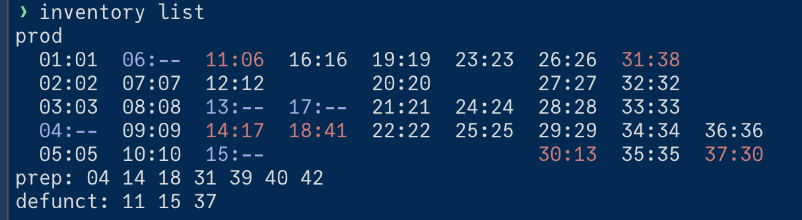

# How to remap nodes in R2lab

When a node is broken, you want to replace it with another spare node.
This requires root access on faraday and preplab, and can be achieved as follows.

On prod, most of the time there is no discrepancy, i.e. node *X* sits on slot
*X* in the chamber. However when a spare node needs to be deployed instead, the
testbed needs to be reconfigured, and this is when you will need `inventory`.

## Background

The tools in this directory configure the testbed deployed on `faraday.inria.fr`
(and its sibling, the preplab), mostly in terms of both:

* `dnsmasq`, that serves DHCP and DNS to the nodes, and
* `rhubarbe`, that offers higher level tools for managing nodes status and images  
  specifically the `publish` command will update `all_scope`, which affects the behaviour of `rhubarbe --all`

### installation / requirements

```bash
# install
pip install -r requirements.txt

# check you have write access
inventory check-ssh

# see overview
inventory help
```

## A typical session

Everything should be doable through a single command `inventory`  
Note that the source code is in r2lab_inventory.py, and `inventory` is just a symlink

as an example to illustrate a typical workflow, let's assuming that

- node 27, that was in slot 27 in prod, is broken
- and we want to replace it with node 42, formerly in the preplab

```terminal
cd r2lab-misc/inventory

# always a good idea
git pull

# you can't move a node to a non-empty slot
# so first free the slot, then fill it
inventory move 27 preplab
inventory move 42 prod:27

# optionally, maintain the note field
inventory set-note 27 "broken CMC"

# check what's expected to be in prod
inventory list --prod

# check what would be pushed, then do it
inventory publish --dry-run
inventory publish

# do not forget to commit the changes into the repo, e.g.
git add nodes.yaml
git commit -m "replaced node 27 in slot 27 with node 42"
git push
```

---

***IMPORTANT NOTE about propagation***  
the `publish` stage pushes a new configuration towards the DNS server; be aware that these changes may take several minutes to propagate, so please be patient

---

### the `list` command

```bash
inventory list [--prod|--prep|--defunct] [-v]`
```

shows where the nodes are. By default it draws the room as in the livemap; each cell is the ceiling slot, then the physical number of the node deployed there, or `--` for an empty slot. On a terminal, the cells where the node differs from the slot number (like `11:06`) are shown in light red, and the empty slots in light blue. This is followed by the nodes in the preplab and the defunct ones (colored in a terminal):



With `-v` you get one line per node instead, with its note field.

### the `move` command

```
inventory move PHY DESTINATION`
```

where the destination is `prod:N`, `preplab` or `defunct`. The free-form note of a node is set with `inventory set-note PHY NOTE` (an empty note removes it).

It fails if the destination slot is busy; so to replace the node in slot 27, first move it out of the way (to `preplab` or `defunct`), and then move the new one in. It also fails on a duplicate slot or MAC, and `list` / `generate` warn about empty prod slots.

### `generate` and `publish`

```bash
inventory generate [--prod|--prep]
```

only computes the files locally, in the current directory:

```terminal
$ inventory generate --prod
WARNING: empty prod slots: 04 06 13 15 17
(Over)wrote prod-inventory-nodes.yaml from nodes.yaml
(Over)wrote prod-dnsmasq              from nodes.yaml
(Over)wrote prod-hosts                from nodes.yaml
```

The warning lists the prod slots that no node is deployed in.

```bash
inventory publish [--prod|--prep] [--dry-run]
```

does a `generate`, then pushes the files to the gateway (`faraday` or the preplab), and restarts `NetworkManager` there, which is what runs `dnsmasq`; without `--prod` or `--prep` it does both. It also updates `all_scope` in `/etc/rhubarbe/rhubarbe.conf.local` on the gateway, to reflect the nodes that are actually there: for faraday that is `all_scope=1-37,~4,~6` where the `~` ones are the empty slots, and for the preplab the list of nodes that sit there.

With `--dry-run` nothing is pushed, but the commands are shown instead, ready to cut and paste; so if you need to push only some pieces, run in dry mode and pick the commands you need:

```terminal
$ inventory publish --prod --dry-run
<snip>
# prod (dry run)
rsync -vrltp prod-inventory-nodes.yaml root@faraday.inria.fr:/etc/rhubarbe/inventory-nodes.yaml
rsync -rltp prod-dnsmasq root@faraday.inria.fr:/etc/NetworkManager/dnsmasq.d/03-testbed.conf
rsync -rltp prod-hosts root@faraday.inria.fr:/etc/hosts
ssh root@faraday.inria.fr 'systemctl restart NetworkManager'
```

### more subcommands

see full list with

```bash
inventory help
```

## about `nodes.yaml`

The single source of truth is `nodes.yaml`. You should ***not need to edit*** this
file by hand; it contains one entry per physical node (the number on the label
glued to the node) like this:

```yaml
42:
  mac: "00:03:1d:0e:03:5b"
  wlan: ["7c:c3:a1:a8:26:9e", "7c:c3:a1:a8:1c:2a"]
  where: {prod: 27}      # or: prep | defunct
  note: "replaced fit27 2025-10"
```

The location of a node, `where`, is one of

* `{prod: N}` - deployed in faraday, at ceiling slot `N` (1..37)
* `prep` - in the preplab (a.k.a. v0)
* `defunct` - out of order

