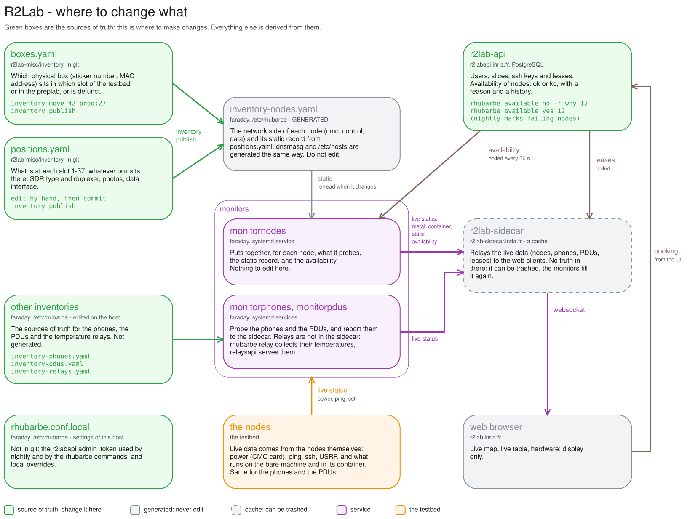

# R2lab inventory : purpose

This subdir contains the tools to keep track of where each physical node sits
(a slot in the prod testbed on `faraday`, the preplab, or defunct),
and to generate the configuration of `dnsmasq` and `rhubarbe` from that.
The data is in `boxes.yaml` (the hardware boxes and where they sit) and `positions.yaml` (what pertains to each slot of the testbed), and the tool is `inventory`.

* [AA-where-to-change-what.excalidraw.svg](AA-where-to-change-what.excalidraw.svg): the sources of truth of the testbed and where to change what (figure below)
* [AA-remap-nodes.md](AA-remap-nodes.md): how to move a node to another location
* [AA-setup-nodes.md](AA-setup-nodes.md): how to set up nodes, BIOS, known issues with CMC cards, etc..
* [AA-firewalld.md](AA-firewalld.md): glitches seen on the preplab with `dnsmasq` and `firewalld`

## Where to change what

The green boxes are the sources of truth; everything else is derived from
them. The figure can be edited with the Excalidraw extension of VS Code, it
is an svg that embeds its own source.
